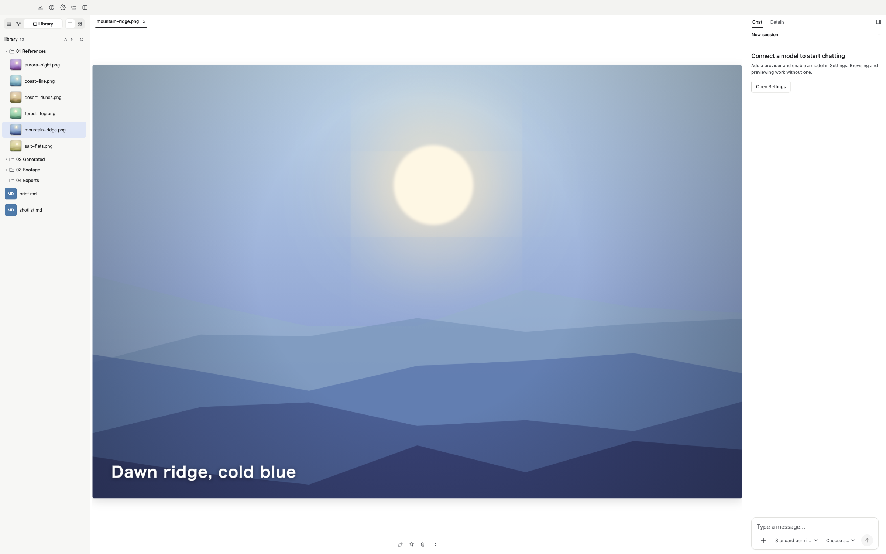
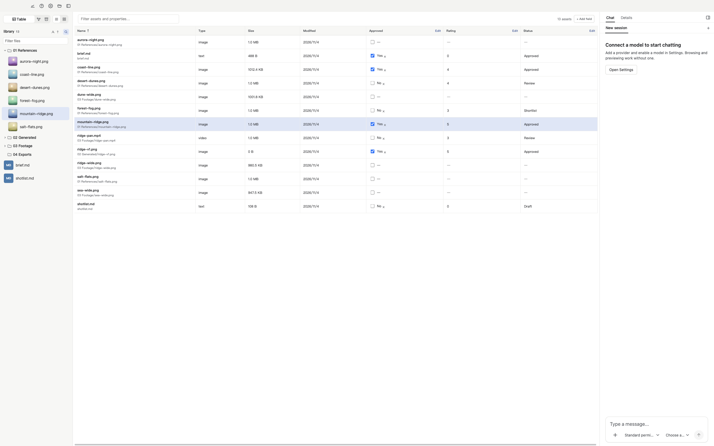
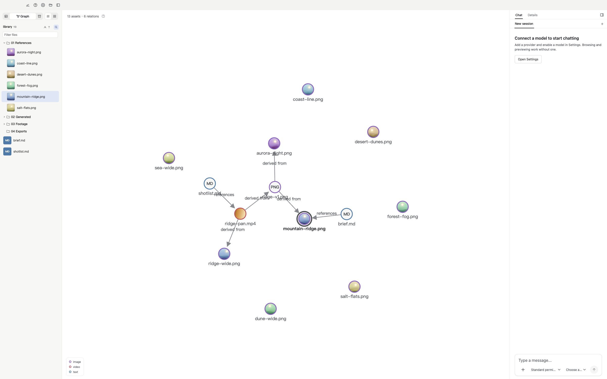

**English** | [简体中文](./README.zh-CN.md)

# Loom

A local-first AI workbench that turns your folders into an asset library you can browse, search, and work with through conversation.

[Website](https://loom.sanzang.site) · [Quick start](#quick-start) · [Development](./docs/DEVELOPMENT.md)

Preview installers for macOS (Apple Silicon and Intel) and Windows x64 are available from the website. You can also run Loom from source using the steps below.



## What you can do

Loom is for anyone who works with images, video, audio, and documents: AI artists and video makers, content creators and editors, photographers, designers, and illustrators.

- **Keep the source of AI-made work.** Link references, generated images, and finished cuts with reference and derivation links, so you can still see where each one came from weeks later.
- **Let the agent tidy your files.** Ask it to sort, rename, and regroup a messy folder, such as filing by type or giving files consistent names. Tags, properties, and relationships follow each file when it moves. In Basic permission mode every file change waits for your approval, and commands run in a sandbox that can only write to your library.
- **Cut, compress, and publish.** Ask the agent to trim, transcode, or compress with FFmpeg; results return to your library. Publishing connects through MCP, and posting to Xiaohongshu has been tested with xiaohongshu-mcp (you set it up and sign in yourself).
- **Find years of references in a sentence.** Keep your folders as they are. Describe and index the assets you want, then search by meaning, for example "warm tones, a backlit street scene".
- **Track every asset in one table.** Add text, number, checkbox, and date columns for status, ratings, clients, and more. Edit them yourself or ask the agent to update many at once.

Also included: browse and preview images, video, audio, PDFs, and Markdown in your own folder layout; organize with tags and favorites; connect creative tools such as ComfyUI through MCP (separate setup and authentication required; available features depend on the server).

Try asking Loom to find a reference image, extract a frame from a video, or mark this week's final cuts as approved. Attach a library file to the composer to identify the asset you mean.

| Organize assets in a table | Trace relationships between assets |
| --- | --- |
| [](./docs/images/asset-table.png) | [](./docs/images/asset-graph.png) |

## Quick start

You need **Node.js ≥22.19.0**, **pnpm**, and macOS or Windows x64. Run these commands from the repository root:

```sh
pnpm install
pnpm dev
```

Installation downloads FFmpeg and ffprobe for your machine. On Windows, the first sandbox installation requests administrator consent.

1. Open a folder as your library and browse your files.
2. To use the agent, add and authenticate a Chat provider in **Settings → Models**, then choose a model in the composer.
3. For semantic search and media understanding, configure the Embedding, VLM, and Audio slots as needed, then select assets to describe or index. Rerank is optional.

Starting the app does not require an API key. During development, a root `.env` containing `DEEPSEEK_API_KEY` can enable DeepSeek on first run; you can also configure providers in Settings. See [model configuration](./docs/SETTINGS.md).

## Your files and model services

Asset files stay in your folders. Loom stores library metadata, indexes, relationships, and conversations in the hidden `.loom/` directory inside each library. To move a library, close Loom and copy the entire folder **including `.loom/`**. App-level model settings and credentials are stored separately; configure them again on the new machine.

Model endpoints can be local or remote. Using a remote provider sends relevant conversation content, text, or media to that provider. Describing and embedding assets happens when you or the agent requests it. Model configuration and provider charges are managed by you.

The agent has permission levels and a process sandbox. MCP servers run outside that sandbox and have their own access. See [permissions and sandboxing](./docs/agent/PERMISSION.md).

## Development

```sh
pnpm test
pnpm -r typecheck
```

`pnpm test` runs workspace package tests. See the [development guide](./docs/DEVELOPMENT.md) for Electron checks, end-to-end tests, package boundaries, and vendor maintenance.

## Technical documentation

- [Agent runtime, tools, and delegation](./docs/agent/AGENT.md)
- [Retrieval and indexing](./docs/RAG/RAG.md)
- [Model configuration](./docs/SETTINGS.md)
- [Permissions and sandboxing](./docs/agent/PERMISSION.md)
- [Memory](./docs/agent/MEMORY.md)
- [Local traces](./docs/agent/TRACE.md)

## License

[MIT](./LICENSE). Vendored components retain their own license files.
