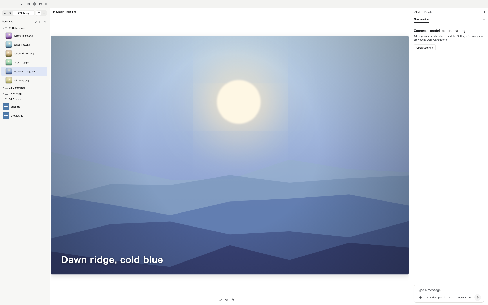
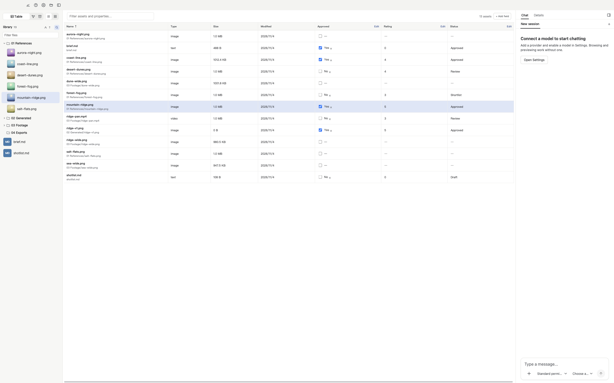
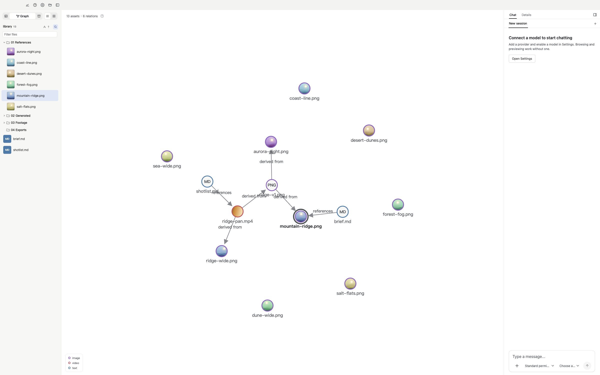

[English](./README.md) | **简体中文**

# Loom

本地优先的 AI 创意素材工作台，把你的文件夹变成可以浏览、检索和通过对话加工的素材库。

[官网](https://loom.sanzang.site) · [快速开始](#快速开始) · [开发文档](./docs/DEVELOPMENT.zh-CN.md)

目前提供 macOS（Apple Silicon 与 Intel）和 Windows x64 的预发布安装包，可从官网获取；也可以按下方步骤从源码运行。



## 可以做什么

适合所有和图片、视频、音频、文档打交道的创作者：AI 绘画与视频创作者、自媒体与剪辑师、摄影师、设计师、插画师。

- **让 AI 作品有出处。** 用「参考」「派生自」把参考图、生成图和成片连起来，几周后回头，仍能看清每张图从哪里来。
- **让 Agent 帮你整理文件。** 让它给杂乱的文件夹分类、重命名、归档，例如按类型归类、统一命名，不必手动一个个处理。文件移动或改名后，标签、属性和关系都会跟着走。在 Basic 权限下，每次改动文件都会先问你；命令在沙盒中运行，只能写入素材库。
- **剪一段、压一下、发出去。** 让 Agent 通过 FFmpeg 截取、转码或压缩，结果回到素材库。发布经 MCP 接入，已实测通过 xiaohongshu-mcp 完成小红书发布（需自行配置并登录）。
- **攒了多年的参考，一句话找回。** 保留原有文件夹，为需要的素材生成描述并建立索引，再按意思检索，例如“暖色调、有逆光的街景”。
- **一张表看清每个素材的进度。** 用文本、数字、勾选和日期列记录状态、评分、客户等信息，可以手动编辑，也可以让 Agent 批量修改。

此外：按自己的目录结构浏览和预览图片、视频、音频、PDF 和 Markdown，用标签与收藏组织素材；通过 MCP 连接 ComfyUI 等创作工具（需另行配置和鉴权，具体能力取决于服务本身）。

可以试试让 Loom 找一张参考图、从视频里截一帧，或把本周的成片标为已审核。把库里的文件放进输入框，就能明确指定要操作的素材。

| 用表格整理素材 | 用关系图追溯创作过程 |
| --- | --- |
| [](./docs/images/asset-table.png) | [](./docs/images/asset-graph.png) |

## 快速开始

准备 **Node.js ≥22.19.0**、**pnpm**，以及 macOS 或 Windows x64。在仓库根目录运行：

```sh
pnpm install
pnpm dev
```

安装依赖时会下载本机的 FFmpeg 和 ffprobe。Windows 首次安装进程沙箱时会请求管理员授权。

1. 打开一个文件夹作为素材库，开始浏览文件。
2. 使用 Agent 前，在**设置 → Models** 中添加 Chat 服务商并完成鉴权，再在输入框中选择模型。
3. 需要语义检索和媒体理解时，按需配置 Embedding、VLM 和 Audio 槽位，再选择素材生成描述或建立索引。Rerank 为可选项。

启动应用不要求 API 密钥。开发时，可以在根目录 `.env` 中设置 `DEEPSEEK_API_KEY`，在首次运行时启用 DeepSeek；也可以直接在设置中配置服务商。详见[模型配置](./docs/SETTINGS.zh-CN.md)。

## 文件与模型服务

素材文件保留在你的目录中。Loom 在每个素材库的隐藏目录 `.loom/` 中保存元数据、索引、关系和会话。迁移素材库时，先关闭 Loom，再复制整个文件夹，**包括 `.loom/`**。应用级模型设置和凭据单独保存，换电脑后需要重新配置。

模型端点可以是本地或远程服务。使用远程服务时，相关对话、文本或媒体会发送给对应服务商。素材描述和嵌入由你或 Agent 显式触发，模型配置与服务商费用由你管理。

Agent 提供权限等级和进程沙箱。MCP 服务运行在该沙箱之外，拥有各自的访问权限。详见[权限与沙箱](./docs/agent/PERMISSION.zh-CN.md)。

## 开发

```sh
pnpm test
pnpm -r typecheck
```

`pnpm test` 运行工作区各包的测试。Electron 自检、端到端测试、包边界与 vendor 维护见[开发文档](./docs/DEVELOPMENT.zh-CN.md)。

## 技术文档

- [Agent 运行时、工具与任务委托](./docs/agent/AGENT.zh-CN.md)
- [检索与索引](./docs/RAG/RAG.zh-CN.md)
- [模型配置](./docs/SETTINGS.zh-CN.md)
- [权限与沙箱](./docs/agent/PERMISSION.zh-CN.md)
- [记忆](./docs/agent/MEMORY.zh-CN.md)
- [本地 Trace](./docs/agent/TRACE.zh-CN.md)

## 许可证

[MIT](./LICENSE)。引入的第三方组件保留各自的许可证文件。
